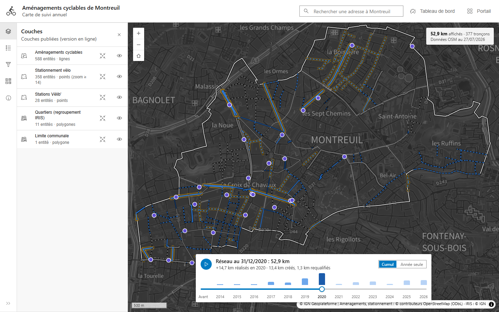
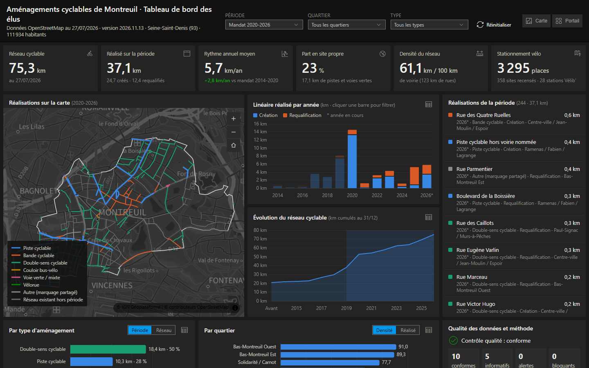

# Montreuil à vélo : suivi annuel des aménagements cyclables

Une **carte interactive** des aménagements cyclables réalisés chaque année à Montreuil (93) et un **tableau de bord**
de synthèse, produits par une chaîne SIG complète et automatisée : données → traitement → publication →
carte web et tableau de bord → mise à jour annuelle. Tout est construit sur des **données réelles** et des
briques ouvertes, sans logiciel sous licence.

> Projet indépendant, non officiel. Données © contributeurs OpenStreetMap (ODbL), © IGN.

## Voir en ligne

**https://jauresmas.github.io/-Montreuil-v-lo/**

- **Portail** : présentation, catalogue des données, état de la chaîne, contrôle qualité et versions
- **Carte web** : couches, légende, filtres, fonds de carte, recherche d'adresse, fiches au clic, curseur temporel
- **Tableau de bord** : indicateurs, graphiques liés entre eux, liste des réalisations, carte, sélecteurs

Les applications acceptent des paramètres d'URL pour partager une vue précise :
`carte/index.html?fond=sombre&mode=annee&annee=2020` · `tableau-de-bord/index.html?periode=m2020`.

Pour ouvrir le projet en local, double-cliquer `ouvrir_portail.bat` (ou `04_applications/index.html`).
Une connexion Internet est nécessaire pour les fonds IGN et les bibliothèques (Calcite, MapLibre, Chart.js).

| Carte web (couleur par année, fond sombre, 2020) | Tableau de bord (mandat 2020-2026) |
|---|---|
|  |  |

Les autres captures (portail, fiche au clic, affichage mobile) sont dans `docs/captures/`.

## Chiffres clés (données OSM au 27/07/2026)

| Indicateur | Valeur |
|---|---|
| Réseau cyclable | **75,3 km**, dont 17,1 km en site propre (23 %) |
| Réalisé depuis 2014 | 54,3 km (40,8 km créés, 13,5 km requalifiés) |
| Mandat 2014-2020 / 2020-2026 | 17,2 km / **37,1 km**, soit un rythme de 2,9 puis 5,7 km/an |
| Année record | 2020 : +14,7 km |
| Densité | 61 km d'aménagements pour 100 km de rues (de 31 à 91 selon les quartiers) |
| Stationnement | 3 295 places recensées sur 358 sites, 28 stations Vélib' |

## La chaîne de production

| Étape | Script / dossier | Ce qui est fait |
|---|---|---|
| **1. Données** | `01_donnees/collecte.py` | Collecte multi-sources : historique complet OSM des aménagements et du stationnement (API ohsome), IRIS (WFS Géoplateforme IGN), limite communale (geo.api.gouv.fr), linéaire de voirie. Manifeste des sources avec empreinte SHA-256. |
| **2. Traitement** | `02_traitement/traitement.py`, `osm_vers_schema.py` | Nettoyage (géométries, micro-segments, doublons), normalisation au **schéma national des aménagements cyclables**, Lambert-93, datation annuelle, rattachement aux quartiers, **15 contrôles qualité** dont certains bloquants. |
| **3. Publication** | `03_publication/publication.py` | Couches publiées en GeoJSON avec leur descripteur de service (champs, alias, emprise), vignettes, catalogue, export au schéma national. Refus si un contrôle bloque, validateur obligatoire en cas d'alerte, archivage de la version précédente. |
| **4. Carte web + tableau de bord** | `04_applications/` | Portail, carte web et tableau de bord, en HTML statique (MapLibre GL JS, Chart.js, Calcite Design System). |
| **5. Mise à jour annuelle** | `05_mise_a_jour/`, `.github/workflows/` | Campagne en deux temps : traitement et rapport d'écarts, puis publication après validation métier. Journal, checklist, modèle de saisie des chantiers livrés. |

### Méthode de datation (clé du « réalisé chaque année »)

Le réseau actuel est découpé en tronçons de 25 m. Chaque tronçon est comparé à l'historique OpenStreetMap
au 1er janvier de chaque année (tampon de 7 m, 80 % de recouvrement) :

- l'année d'apparition d'un aménagement **du même type** donne l'**année de réalisation** ;
- s'il existait déjà un aménagement **d'un autre type**, c'est une **requalification** (ex. bande → piste) ;
- le réseau présent au 1er janvier 2014 est classé « Avant 2014 » ;
- un `start_date` renseigné dans OSM sur une piste en site propre est prioritaire.

## Ce qui garantit la réussite du projet

1. **Un référentiel unique et normé** : le schéma national Etalab rend la donnée comparable d'une année à
   l'autre et publiable telle quelle sur transport.data.gouv.fr.
2. **Une date de réalisation fiable** : ici reconstituée par l'historique OSM. En production, elle vient de la
   voirie (plans de récolement, fiches chantier, DAO), rapprochée chaque année via `modele_saisie_chantiers.csv`.
3. **Deux clés avant publication** : un contrôle qualité automatique qui bloque, puis une validation métier
   humaine tracée (`--valide-par` en local, fusion de la pull request sur GitHub).
4. **La traçabilité** : manifeste des sources, journal des campagnes, historique Git, historique des
   publications visible sur le portail.
5. **Des indicateurs définis avec les élus et stables** : définitions écrites (km de voie, site propre,
   densité, création ou requalification) et inchangées d'une année sur l'autre, pour que les séries restent comparables.
6. **L'automatisation et un calendrier** : une campagne automatique le 15 janvier. Le paramétrage est
   concentré dans `config.py`, ce qui facilite la transmission et permet de lancer la chaîne sur une autre commune.
7. **L'accessibilité** : palette testée pour le daltonisme, vue tableau de chaque graphique, affichage mobile.
8. **L'ouverture et le retour à la source** : données sous ODbL ; les erreurs repérées sont corrigées dans OSM,
   ce qui améliore la campagne suivante.

## Mise à jour annuelle sur GitHub

Trois workflows GitHub Actions font tourner la chaîne sans poste de travail :

1. **`mise-a-jour-annuelle.yml`**, le 15 janvier (ou à la demande depuis l'onglet Actions) : pour **chaque commune
   publiée**, l'une après l'autre, collecte, traitement et contrôle qualité. Si rien ne bloque, il ouvre une
   **pull request par commune** dont la description est le rapport d'écarts ; la couche des écarts est jointe au
   workflow pour être ouverte dans QGIS. Un contrôle bloquant n'arrête que la commune concernée. Lancé à la main,
   il accepte le code INSEE d'une seule commune.
2. **`publier-et-mettre-en-ligne.yml`**, à chaque envoi sur `main` : il repère les communes dont le traitement est
   plus récent que la version en ligne, c'est-à-dire celles dont la pull request de campagne vient d'être fusionnée.
   Il les republie avec le nom de la personne qui a fusionné (la fusion vaut validation métier), puis met le site
   en ligne sur GitHub Pages.
3. **`controle-pull-request.yml`**, à chaque pull request (contributions extérieures comprises) : il vérifie ce
   qu'un relecteur vérifierait avant de fusionner et affiche ✅ ou ❌ sur la pull request, avec le détail dans le
   résumé du workflow :
   - communes touchées, code ou workflows modifiés (signalés « à relire ») ;
   - contrôle qualité non bloquant, version publiée identique au traitement, données des applications à jour ;
   - liste des communes et comparaison à jour, crédit et licence présents ;
   - portail, carte, tableau de bord et comparaison qui s'ouvrent sans erreur et affichent la bonne commune.

   Le script de contrôle (`05_mise_a_jour/controle_pr.py`) est toujours pris dans `main` : une pull request ne
   peut pas affaiblir son propre contrôle. Pour une première contribution d'une personne extérieure, GitHub
   demande d'autoriser le lancement du contrôle (bouton *Approve and run* sur la pull request).

Réglages à faire une fois dans le dépôt (**Settings**) :

- **Pages** → *Build and deployment* → *Source* : **GitHub Actions** ;
- **Actions** → *General* → *Workflow permissions* : cocher **Allow GitHub Actions to create and approve pull requests**.

## Lancer une campagne en local (Windows)

```bat
python -m venv .venv
.venv\Scripts\pip install -r requirements.txt
05_mise_a_jour\maj_annuelle.bat     :: collecte, traitement, contrôle, rapport d'écarts
05_mise_a_jour\publier.bat          :: après relecture de la checklist : archive la version précédente et republie
```

## Faire tourner la chaîne sur une autre commune

Le projet est pensé pour Montreuil, mais la chaîne fonctionne aussi pour une autre commune française.
Il suffit de donner son code INSEE au lancement (ici Villeurbanne) :

```bat
05_mise_a_jour\maj_annuelle.bat --commune 69266
05_mise_a_jour\publier.bat --commune 69266
```

- Chaque commune a ses propres dossiers (`brutes/<commune>/`, `sorties/<commune>/`, `services/<commune>/`,
  `data/<commune>/`, `archives/<commune>/`) et son propre journal : son contrôle qualité ne se compare qu'à elle-même.
- Le nom et le département sont lus sur geo.api.gouv.fr. Les quartiers sont les IRIS de la commune, sauf si un
  regroupement est défini pour elle dans `config.py` (comme pour Montreuil).
- Les stations de vélos en libre-service sont reconnues quel que soit le réseau (Vélib', Vélo'v…).
- Les applications affichent la commune par défaut (Montreuil). Une autre commune publiée s'ouvre avec
  `?commune=<commune>`, par exemple `tableau-de-bord/index.html?commune=villeurbanne`, ou depuis le choix de
  la commune du portail.
- Une fois publiée, la commune entre dans la campagne automatique du 15 janvier sur GitHub, avec sa propre
  pull request à valider.

### Comparer les communes

Dès que deux communes sont publiées, la page `comparaison/index.html` les met côte à côte. On y accède depuis
le portail (bloc « Comparer les communes ») ou le bouton « Comparer » du tableau de bord.

- Les chiffres sont ramenés à la population légale (INSEE, via geo.api.gouv.fr) et à la longueur de voirie :
  réseau pour 10 000 habitants, km pour 100 km de voirie, part en site propre, croissance du réseau depuis 2020,
  places de stationnement pour 1 000 habitants.
- Un classement par indicateur, l'évolution du réseau depuis 2014 et un tableau triable de tous les indicateurs.
- `?commune=<commune>` met une commune en avant, `?indicateur=densite` choisit l'indicateur du classement.
- Les données viennent de `03_publication/comparaison.py`, lancé à chaque publication. Il rassemble les
  indicateurs de toutes les communes publiées dans `services/comparaison.json` (téléchargeable) et
  `data/comparaison.js`.
- Limite : OpenStreetMap est collaboratif, un écart entre deux villes peut aussi venir d'un recensement plus ou
  moins complet.

## Arborescence

```
index.html                   redirection vers le portail (page d'accueil du site)
config.py                    paramètres communs (commune, année de référence, tolérances)
01_donnees/                  collecte.py, brutes/<commune>/ (seul manifest.json est versionné)
02_traitement/               traitement.py, osm_vers_schema.py, sorties/<commune>/ (GPKG Lambert-93, GeoJSON, QC, indicateurs)
03_publication/              publication.py, comparaison.py, services/<commune>/ (couches, descripteurs, vignettes, catalogue),
                             services/comparaison.json
04_applications/             index.html (portail), carte/, tableau-de-bord/, comparaison/, assets/,
                             data/<commune>/donnees.js, data/communes.js, data/comparaison.js
05_mise_a_jour/              maj_annuelle.py, controle_pr.py, checklist, modèle de saisie, journaux/<commune>.md
.github/workflows/           campagne annuelle, mise en ligne, contrôle des pull requests
docs/captures/               captures d'écran des applications
```

## Limites connues

- La date de cartographie dans OSM peut suivre de quelques semaines à quelques mois la date des travaux.
  Les premières années (2014-2016) reflètent aussi le rattrapage de la cartographie.
- 2026 est partiel : l'API ohsome a environ trois mois de décalage (données au 27/07/2026).
- Le linéaire est mesuré en axe de voie : une rue équipée des deux côtés compte une fois.
- Trois voies portaient une piste notée sur la route alors qu'elle est déjà dessinée à part (boulevard Chanzy,
  boulevard de la Boissière), soit 0,44 km compté deux fois. Le traitement les corrige automatiquement (contrôle C10),
  mais la correction n'est pas faite dans OSM : il faut la reporter dans OSM pour assainir la source.
- Les quartiers sont un regroupement des 41 IRIS de l'INSEE, pas le découpage officiel des quartiers de la Ville.
- Le stationnement est un inventaire OSM : sa progression reflète aussi l'effort de recensement.

## Briques utilisées

Python (geopandas, shapely, pyproj) · API ohsome (HeiGIT) · Géoplateforme IGN (WFS, WMTS, géocodage) ·
API Découpage administratif · Calcite Design System (Apache-2.0) · MapLibre GL JS (BSD-3) · Chart.js (MIT) ·
GitHub Actions et GitHub Pages.

## Licence et crédit

Le code est publié sous licence MIT (voir [LICENSE](LICENSE)) : vous pouvez le réutiliser, le modifier et le
déployer pour votre commune. En retour, merci de conserver le crédit affiché en pied de page du portail, dans
« À propos » de la carte, dans « Méthode et sources » du tableau de bord et sur la page de comparaison. Il est défini à un seul endroit,
la constante `credit` de [04_applications/assets/commun.js](04_applications/assets/commun.js).

Les données gardent leurs propres licences : OpenStreetMap (ODbL, © contributeurs OpenStreetMap),
IRIS et fonds de carte © IGN.
